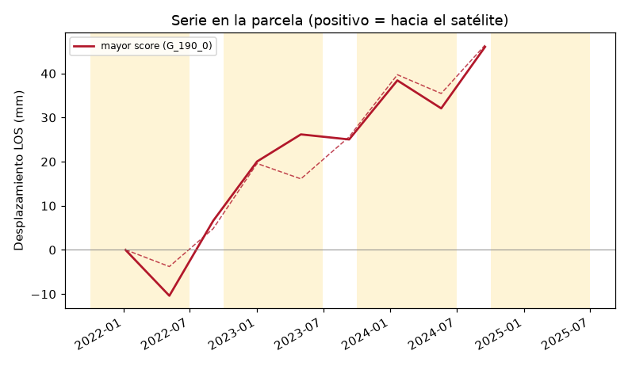
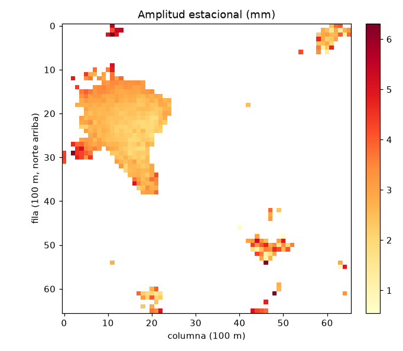
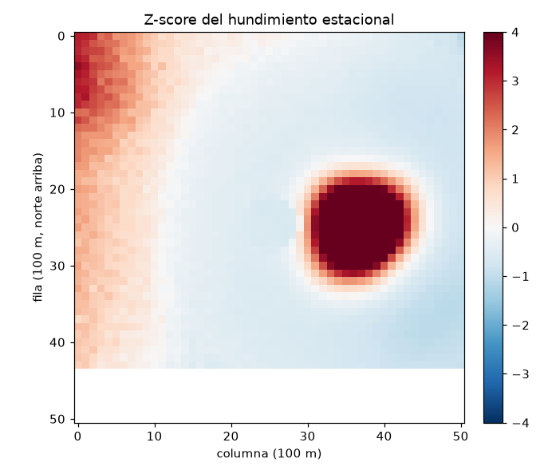

# PoC: pozos ilegales en Doñana con InSAR (NISAR + Sentinel-1)

Prueba de concepto para el reto *Dancing with the SARs* (NASA Space Apps 2026).
La hipótesis: las extracciones no declaradas de agua subterránea dejan un cono
de subsidencia local y estacional, visible con interferometría SAR, y se puede
separar del bombeo legal cruzándola con el registro de captaciones, la
superficie agraria regable (SAR) y el NDVI de la campaña de la fresa.

Esto es un estudio de **viabilidad del método**, no un censo de pozos y no una
acusación sobre ninguna parcela real. El modo sintético, que es el que se puede
ejecutar sin cuentas, fabrica los pozos, la SAR y los interferogramas. Un "go"
en ese modo solo dice que el código recupera la señal que él mismo inyectó.

La explicación de cada paso, de la física y de cada archivo está en [`docs/`](docs/README.md).

## Resultado de la corrida sintética (tesela de Rociana, 50 m)

Escena de 5×5 km, 24 fechas mensuales (2023-01 a 2024-12), 44 interferogramas
con rampa atmosférica y ruido, 8 conos de 12 mm de amplitud junto a pozos no
registrados (dos de los ocho pozos "cerrados" no llevan cono, a propósito).

| Criterio | Valor | Decisión |
|---|---|---|
| Coherencia > 0.4 en campaña de riego (abr-jun) | 86 % de los píxeles | go (umbral 30 %) |
| Exceso de hundimiento en las celdas con z > 2 | mediana 30 mm, anomalías agrupadas | go (umbral 5 mm) |
| Anomalías fuera de SAR y sin pozo, junto a puntos documentados | 0 % caen junto a un pozo registrado; 90 % de las inexplicadas caen junto a un punto WWF/cierre | go |
| Pozos cerrados dentro de una celda con z > 2 | 6 de 8 (75 %) | go (umbral 50 %; no-go < 20 %) |

Los dos cierres no detectados son los que se generaron sin cono: el recuerdo
no sale al 100 % y eso es lo esperable. Los piezómetros sintéticos bajan
~1,9 m en primavera junto a las anomalías y ~0,3 m lejos de ellas.

La parcela de mayor score es `I-011` (99,5 sobre 100): fuera de la SAR, sin
pozo declarado, NDVI de campaña ~0,66. La de menor score está dentro de la SAR
y ronda 5 puntos. Serie temporal (banda amarilla = campaña de fresa, octubre-junio):






**Esto no es un go científico sobre Doñana.** Falta la serie real. Lo que sí
queda medido, con el catálogo público consultado el 2 de noviembre de 2026
sobre la tesela, está en [Qué falta para datos reales](#qué-falta-para-datos-reales).

## Área

Sector norte de la corona forestal, acuífero Almonte-Marismas, en torno a
Rociana del Condado (Huelva).

- Tesela de trabajo: 5×5 km centrada en 37,30 N, 6,58 O. Es el valor por defecto
  de `config.yaml` (`aoi.activa: tesela_rociana`).
- Bbox completo, cuando se quiera ampliar: longitud −6,70 a −6,48, latitud
  37,20 a 37,40. Se cambia una clave, no el código:

```yaml
aoi:
  activa: bbox_completo
```

El punto de referencia estable es el casco urbano de Rociana (las mismas
coordenadas). El CRS de trabajo es ETRS89 UTM huso 29 (`EPSG:25829`). El bbox
completo cruza el meridiano −6° (límite con el huso 30); se mantiene un solo
huso para no partir la pila. El error de escala en el borde este es
irrelevante a 100 m.

## Entorno

```bash
conda env create -f environment.yml
conda activate poc-donana
```

Si no hay conda:

```bash
pip install -r requirements.txt
```

Python 3.11 o posterior. Los scripts buscan `python` y, si no está, `python3`.
MintPy no entra en este entorno: es la opción B y tiene su propio fichero,
`environment-opcion-b.yml`.

Las credenciales no se escriben en el repo. Copie el ejemplo y rellénelo en
local; `.env` está en `.gitignore`.

```bash
cp .env.example .env
```

| Variable | Para qué | Notas |
|---|---|---|
| `EARTHDATA_TOKEN` | Descargar de ASF (NASA Earthdata, token de portador) | La búsqueda del catálogo funciona sin token |
| `CDSE_USERNAME` y `CDSE_PASSWORD` | Descargar de Copernicus Data Space | Preferidas: el access token caduca en unos 10-30 min y el cliente lo renueva solo |
| `CDSE_ACCESS_TOKEN` | Alternativa al par usuario/clave | No se puede renovar; al caducar la descarga responde 401 |

Cuentas, gratuitas:

- Earthdata: <https://urs.earthdata.nasa.gov/>
- Copernicus Data Space: <https://dataspace.copernicus.eu/>

El código solo lee el entorno (y un `.env` local si existe). No hay tokens en
los YAML ni en los CSV de catálogo.

## Modo sintético

No llama a la red. Genera interferogramas GeoTIFF (fase desenvuelta en
radianes + coherencia), parcelas, una SAR ficticia, pozos registrados, pozos
cerrados, puntos tipo WWF, NDVI y piezómetros. Todo lleva `sintetico=True` y
hay un manifiesto en `data/raw/MANIFIESTO_SINTETICO.json`.

```bash
bash ejecutar_sintetico.sh
```

Equivale a:

```bash
bash src/download.sh            # modo: sintetico en config.yaml
python src/procesar_insar.py    # máscara, rampa, referencia, inversión
python src/medir.py             # velocidad, amplitud, z-score, GeoTIFF
python src/score.py             # cruce legal, score y validación go/no-go
```

Salidas (están en `.gitignore`; se regeneran):

| Ruta | Qué es |
|---|---|
| `data/procesado/serie_mm.npz` | Desplazamiento LOS (mm) por fecha y píxel |
| `data/resultados.parquet` | Malla de 100 m con las mediciones |
| `data/parcelas_score.parquet` y `.gpkg` | Parcelas ordenadas por score |
| `data/geotiff/*.tif` | z-score, amplitud, velocidad, coherencia, hundimiento, para QGIS |
| `data/validacion.json` | Los cuatro criterios y el apoyo de piezómetros |
| `data/figuras/*.png` | Mapas de control y la serie de ejemplo |

Visor:

```bash
streamlit run src/visor.py
```

Pruebas:

```bash
python -m pytest
```

## Modo real

En `config.yaml`, `modo: real` (o `bash src/download.sh --real`).

```bash
bash src/download.sh --real --listar   # solo catálogos, sin binarios
bash src/download.sh --real            # ASF + Copernicus + capas
python src/ndvi_s2.py                  # cuando haya L2A y parcelas SIGPAC
python src/procesar_insar.py
python src/medir.py
python src/score.py
streamlit run src/visor.py
```

Qué baja cada fuente:

- **ASF**: NISAR GUNW (desde 2025-10, el producto del reto) y, si se activan,
  los GUNW de ARIA Sentinel-1 y los SLC (estos últimos solo para la opción B:
  `descarga.sentinel1_slc: true`).
- **Copernicus**: Sentinel-2 L2A con nubes < 20 % y, si el filtro devuelve
  algo, el DEM GLO-30. El DEM solo hace falta para procesar SLC desde cero.
- **Capas**: WFS de captaciones de la CHG. El resto (SIGPAC, polígono SAR,
  pozos cerrados, muchas veces los piezómetros) no tiene una descarga estable:
  el script deja `data/raw/capas/LEEME_CAPAS.txt` y los pasos están en
  [`docs/02-descarga-de-datos.md`](docs/02-descarga-de-datos.md).

Los GUNW reales (HDF5 de NISAR o de ARIA) se leen junto a los GeoTIFF. No se
mezclan plataformas en la misma inversión: banda L y banda C no comparten
longitud de onda ni geometría de visión. `procesado.plataforma: auto` se queda
con la que tenga más pares.

Antes de interpretar un signo (subsidencia negativa), hay que contrastar
`procesado.signo_fase` con un punto conocido. El convenio por defecto es
`d_mm = -(λ / 4π) · fase · 1000` (fase positiva = alejamiento del satélite).

## Cómo se puntúa una parcela

Sobre las parcelas que tienen celdas de 100 m:

```
score = 40 · norm(amplitud estacional)
      + 30 · norm(velocidad de subsidencia)
      + 20 · norm(NDVI de campaña, octubre-mayo)
      + 10 · (1 si no hay pozo declarado a < 500 m y la parcela está fuera de la SAR)
```

`norm` es un mínimo-máximo entre las parcelas de la tesela, de 0 a 1.
La velocidad de subsidencia es la parte negativa de la velocidad, cambiada de
signo: el levantamiento no suma. El buffer de 500 m alrededor de cada celda
con z > 2 no entra en la fórmula; marca la columna `en_buffer_anomalia`.
Si falta la capa de pozos o la SAR, ese +10 vale 0: no se interpreta una capa
ausente como "sin pozo" o "fuera de ordenación".

## Cómo leer el go / no-go

`data/validacion.json` tiene `decision_tuberia` y, separado,
`decision_cientifica_donana`. En modo sintético la segunda queda en
`pendiente_de_datos_reales` aunque la primera sea `go`.

| Criterio | Go | No-go |
|---|---|---|
| Coherencia en campaña de riego | > 30 % de píxeles con coherencia > 0.4 | < 5 % (cultivo sin píxeles coherentes) |
| Señal local | Mediana del exceso (celda − anillo) en las celdas con z > 2, ≥ 5 mm, y anomalías agrupadas | < 2 mm, o z-score sin estructura espacial |
| Cruce legal | Las anomalías sin pozo y fuera de SAR coinciden con lo documentado (WWF / cierres) y no se concentran en pozos legales | ≥ 80 % de las anomalías junto a un pozo legal y casi ningún solape con lo documentado |
| Pozos cerrados | > 50 % caen en una celda con z > 2 | < 20 % |

Entre los dos umbrales el criterio queda en `indeterminado`. La decisión global
es `go` solo si los cuatro lo son; con un solo `no-go`, la global es `no-go`.
Los piezómetros se informan aparte (la spec los pide como comprobación, no como
umbral): el nivel debe caer más donde hay anomalía.

Si la señal no supera el ruido, el siguiente paso no es dar por cerrado el
enfoque: es la opción B (SBAS con MintPy sobre SLC de Sentinel-1). Está
descrita en [`docs/08-opcion-b-mintpy.md`](docs/08-opcion-b-mintpy.md).

## Qué falta para datos reales

Consulta al catálogo público el 2 de noviembre de 2026, tesela de Rociana,
sin descargar binarios (en esta máquina no hay token de Earthdata ni cuenta
CDSE):

- **NISAR GUNW**: 36 productos desde el 27 de junio de 2026 hasta el 8 de
  octubre de 2026, ascendentes y descendentes, pares de 12 días. La serie es
  real y ya se puede apilar, y es corta para un seno anual: cubre un verano y
  el inicio del otoño, no una campaña de fresa completa. Sirve para coherencia
  en banda L y como relato del reto; no basta, sola, para el ajuste estacional.
- **ARIA Sentinel-1 GUNW**: 0 gránulos intersectan la tesela (2022-2026). La
  serie larga no viene hecha. Sí hay SLC de Sentinel-1 (el filtro de enero-junio
  de 2024 devuelve productos). Hay que procesarlos (opción B) o encontrar otro
  archivo de interferogramas.
- **Sentinel-2 L2A**: el filtro de nubes < 20 % responde. La tesela cae en el
  tile MGRS `T29SQB`. Hace falta bajar las escenas y tener las parcelas SIGPAC
  para agregar el NDVI.
- **DEM GLO-30**: el filtro OData `Collection/Name eq 'COP-DEM'` devolvió 0
  productos el mismo día, incluso sin recorte espacial. La opción A no lo
  necesita. Para la B, bajarlo del Copernicus Browser si el catálogo sigue vacío.
- **CHG**: el WFS de captaciones está implementado
  (`ggiscloud_root:captaciones_dph`). No se ha ejecutado la descarga completa
  en esta corrida.
- **SIGPAC, SAR y pozos cerrados**: sin API estable. Sin el polígono SAR y sin
  una capa georreferenciada de los cierres, el score legal y el recuerdo se
  quedan en indeterminado por falta de datos, no por falta de señal.

## QGIS

Abrir `data/geotiff/zscore.tif` (EPSG:25829, nodata −9999) encima del PNOA.
Los otros rásteres del mismo directorio comparten rejilla: amplitud estacional,
velocidad, hundimiento estacional y coherencia media.

## Documentación

| Documento | Contenido |
|---|---|
| [docs/01-area-y-configuracion.md](docs/01-area-y-configuracion.md) | AOI, CRS, `config.yaml` |
| [docs/02-descarga-de-datos.md](docs/02-descarga-de-datos.md) | ASF, CDSE, WFS y los pasos manuales |
| [docs/03-procesamiento-insar.md](docs/03-procesamiento-insar.md) | Coherencia, rampa, referencia, inversión |
| [docs/04-mediciones.md](docs/04-mediciones.md) | Velocidad, seno anual, anillo, z-score |
| [docs/05-cruce-legal-y-score.md](docs/05-cruce-legal-y-score.md) | Buffer, NDVI y la fórmula |
| [docs/06-validacion-go-nogo.md](docs/06-validacion-go-nogo.md) | Umbrales y cómo no leer de más |
| [docs/07-visualizacion.md](docs/07-visualizacion.md) | Visor y GeoTIFF |
| [docs/08-opcion-b-mintpy.md](docs/08-opcion-b-mintpy.md) | SBAS si la opción A se queda corta |
| [docs/09-riesgos-y-limitaciones.md](docs/09-riesgos-y-limitaciones.md) | Qué puede tumbar la hipótesis |
| [docs/10-inventario-de-archivos.md](docs/10-inventario-de-archivos.md) | Cada script, cada salida |
| [docs/11-guia-ejecucion-local.md](docs/11-guia-ejecucion-local.md) | Instalar, cuentas, URLs y comandos en tu PC |
| [docs/12-comparacion-nisar-s1.md](docs/12-comparacion-nisar-s1.md) | Por qué la comparación sigue no_evaluable |
| [docs/14-protocolo-comparacion.md](docs/14-protocolo-comparacion.md) | Reglas del porcentaje de error, sin informe final |
| [docs/resultados-datos-reales.md](docs/resultados-datos-reales.md) | Informe de la corrida real (HyP3 + NDVI) |

## Licencia de los datos

Los productos NISAR, Sentinel y las capas administrativas tienen sus propias
condiciones (Earthdata, CDSE, CHG, SIGPAC, MITECO). Este repositorio no
redistribuye ninguno. El código de la PoC se puede reutilizar; los datos
sintéticos no deben citarse como mediciones.
