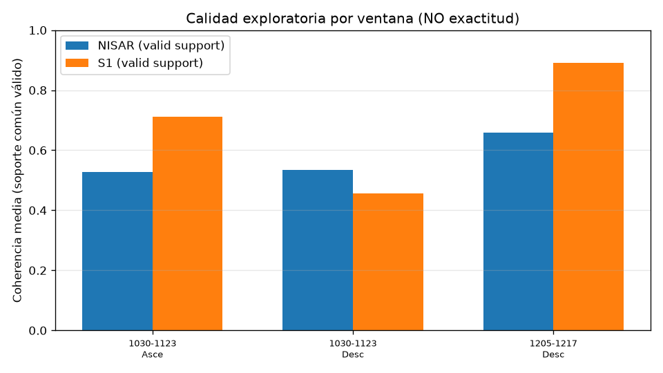

# Informe de viabilidad provisional

**Estado: provisional.** Paquete del 5 de noviembre de 2026, 21:14 (Europa/Madrid), `partial: true`. Falta el cuarto caso: el Sentinel-1 ascendente del 4 al 16 de diciembre de 2025. El job HyP3 ya figura como SUCCEEDED; el ZIP seguía descargándose cuando se cerró este paquete. Otro trabajo lo incorporará. Este texto no es el informe final y no se fusiona a `main` por sí solo.

No se ha vuelto a calcular ningún ráster. Las cifras salen de `docs/evidencia-parcial-2026-11-05/`. No hay porcentaje de exactitud.

## Hoja ejecutiva

| Decisión | Estado |
|---|---|
| ¿Se puede observar deformación en la tesela, como piloto? | Sí: la cadena NISAR GUNW + HyP3 está ejecutada en tres ventanas. No está validada. |
| ¿NISAR mejora la exactitud frente a Sentinel-1? | **No evaluable.** `accuracy_improvement_pct` es null. |
| ¿NISAR tiene más coherencia que Sentinel-1? | No de forma uniforme. En dos de los tres casos, en el soporte común, Sentinel-1 está por encima. |
| ¿Eso demuestra pozos o ilegalidad? | No. La subsidencia no identifica un pozo. La falta de inventario no es ilegalidad. |
| ¿Hasta dónde llega el dato? | Tesela 5×5 km de Rociana y, aparte, el bbox de ~20 km en EGMS. Ni toda Doñana ni todo 2025. |

Limitaciones que no se levantan en este texto: signo de fase sin anclar; dos pares NISAR desconectados (24 días y 12 días, sin fechas compartidas); línea de visión distinta (NISAR izquierda, Sentinel-1 derecha; ángulos entre vectores 87,1° y 22,5°); GNSS a 29–61 km; EGMS derivado de Sentinel-1 y sin fechas de diciembre.

## Qué se cita y qué no

Fuente principal: tres registros de `controlled_pairs_descriptive.csv`. Cada uno es una ventana, con el mismo soporte espacial, y `n_independent_time_pairs = 1`. Los conteos `n_common_valid` y `n_common_usable` son píxeles, no tiempos.

No se cita la media de coherencia NISAR 0,6002 (dos ventanas) contra un solo par ascendente de Sentinel-1. Ese agregado está rechazado en la auditoría del propio paquete.

La diferencia que se lee primero es la absoluta: coherencia NISAR menos coherencia Sentinel-1, en el soporte común válido. El porcentaje `100 * (NISAR − S1) / S1` se deja en la tabla solo como calidad exploratoria. No es exactitud y no se generaliza fuera de estas tres ventanas.

## Tres casos, soporte común

Rejilla: NISAR nativo, 80 m, EPSG:32630. Sentinel-1 se acerca por vecino más próximo; la coherencia no se promedia al remuestrear. Desfase de fechas: un día en cada extremo. El identificador del CSV repite la ventana del 30 oct–23 nov para el ascendente y el descendente; aquí se separan por la geometría, que es lo que el fichero sí distingue.

| Caso | Sentinel-1 | Ángulo entre LOS | n válido | n usable común | Coh. NISAR | Coh. S1 | Δ absoluta | Δ % exploratoria | Exactitud |
|---|---|---:|---:|---:|---:|---:|---:|---:|---|
| 30 oct–23 nov, S1 ascendente | `S1AA_…_DCB0` | 87,1° | 2950 | 2676 | 0,526 | 0,711 | −0,185 | −26,0 | null |
| 30 oct–23 nov, S1 descendente | `S1CC_…_B181` | 22,5° | 1949 | 1263 | 0,534 | 0,456 | +0,078 | +17,0 | null |
| 5–17 dic, S1 descendente | `S1CC_…_C9F5` | 22,5° | 2459 | 2398 | 0,660 | 0,892 | −0,232 | −26,0 | null |

Δ absoluta = coherencia NISAR − coherencia Sentinel-1 sobre `n_common_valid`. Negativa: en ese soporte NISAR queda por debajo. El cuarto caso (S1 ascendente 4–16 dic 2025, `S1AA_…_6F69`) no está en la tabla.



La fracción usable nativa no es esta tabla. En el AOI de 5×5 km, sin exigir el otro sensor, el NISAR del 30 oct–23 nov tiene 0,657 de píxeles con coherencia ≥ 0,3 (2701 / 4111) y el del 5–17 dic tiene 0,970 (3986 / 4111). El descendente Sentinel-1 del 29 oct–22 nov, en su propia retícula, baja a 0,387. Mezclar esas fracciones con las medias del soporte común cambia la conclusión. No se mezclan.

Hay además un ascendente Sentinel-1 del 22 nov al 4 dic 2025 (`S1AA_…_4D20`) ya leído en calidad nativa. No entra en los tres casos: sus fechas no caen a menos de dos días de ninguno de los dos pares NISAR.

## Por qué el desplazamiento no se compara

NISAR, en los dos productos, es ascendente y mira a la izquierda. El vector hacia el satélite, en el punto de referencia, tiene componente este positiva (≈ 0,69) y vertical ≈ 0,70; la incidencia aproximada es 45,7°. Sentinel-1 IW mira a la derecha. El ascendente de octubre–noviembre apunta al oeste (este ≈ −0,65) y forma 87,1° con el vector NISAR. Los descendentes forman unos 22,5°. Ascendente con ascendente no es la misma línea de visión.

El signo de la fase sigue sin anclar. Por eso no se publican aquí los percentiles de una «vertical» obtenida dividiendo el desplazamiento por la componente vertical del vector: cambiarían de signo con el convenio, y la correlación entre mapas (0,13, 0,10 y 0,06 en el CSV) no es una medida de acuerdo. `accuracy_improvement_pct` queda null. La fórmula `100 * (err_S1 − err_NISAR) / err_S1` solo se aplicará cuando exista un control independiente y el baseline de error sea mayor que cero. Ahora no se aplica.

Los dos pares NISAR no comparten fechas. No forman una red temporal conectada. n = 2 pares, cada comparación con n temporal = 1.

## GNSS

Hay cuatro series NGL IGS20 descargadas, con datos que llegan a 2026-10-17: HUE1 (29 km), HULV (30 km), HUEL (32 km) y LEBR (61 km) respecto al centro de Rociana. Ninguna cae dentro de la tesela. No se usaron para un RMSE en línea de visión ni para un porcentaje de exactitud. No se diga que no hay GNSS. Lo correcto es que no hay control local anclado a las parcelas.

## EGMS

El release 2020_2025 está autenticado y leído. No es verdad independiente: sale de Sentinel-1. Las unidades del formato v3 son velocidad media en mm/año y `rmse_ts` en mm. La tesela de 5×5 km y el bbox de unos 20 km están resumidos por separado en `egms_resumen_ambos_aoi.csv`. Las series de ese release llegan al 25, 28 o 29 de noviembre de 2025. En la ventana de octubre–noviembre hay unas pocas fechas solapadas con el primer GUNW; en la de diciembre, el recuento del paquete es 0. No se usa EGMS para validar el par de diciembre ni para hablar de toda Doñana o de todo 2025.

## Sentinel-1 del 1 de noviembre de 2026

El producto `S1DD_20261020T062623_20261101T062623` es descendente, del 20 de octubre al 1 de noviembre de **2026**. El job HyP3 terminó. No se compara con los GUNW de 2025: no hay intersección de fechas. En calidad nativa, 1115 de 4112 píxeles del AOI son válidos (fracción usable 0,270). Eso describe ese par, no NISAR.

## Qué rescata el proyecto

La pregunta sigue en pie y el piloto ya produce observación: dos GUNW NISAR geocodificados en EPSG:32630, con fase en radianes y λ = 0,2439320244 m, y pares HyP3 de la misma quincena, leídos en el mismo soporte de 80 m. El protocolo distingue calidad de imagen y exactitud, y niega el agregado de ventanas distintas. Eso es utilizable. Lo que no está demostrado es que esa deformación localice pozos, ni que una parcela sin ficha en el inventario sea ilegal.

## Siguientes pasos, en este orden

1. Cerrar el ZIP ascendente del 4–16 de diciembre de 2025 y añadir el cuarto caso con el mismo soporte común, sin promediarlo con los tres anteriores.
2. Sustituir los dos pares NISAR sueltos por una red de pares de 12 días que compartan fechas, en la geometría que se vaya a interpretar.
3. Anclar el signo y la atmósfera con geodesia dentro de la tesela, y proyectar el GNSS a cada línea de visión por separado. Los vectores de HyP3 (desplazamiento, incidencia, look) son el insumo; no se restan mapas de distinta mirada.
4. Pedir a la CHG las series piezométricas como hidrología. No entran en el RMSE de desplazamiento.
5. Usar Sentinel-2, evapotranspiración o el calendario de riego, más SIGPAC y el registro de concesiones, para ordenar parcelas. La validación, si se hace, es precisión y recall sobre una etiqueta fijada antes, no una prueba de ilegalidad.

## Criterios de éxito del piloto

Se fijan ahora, sin tomarlos de las coherencias de esta tabla.

- Hay una cadena de pares de 12 días, en una geometría declarada, que cubre la campaña de riego de octubre a junio y en la que cada fecha intermedia pertenece a dos pares consecutivos.
- El signo de la fase se contrasta con un control geodésico situado dentro de la tesela de 5 km, proyectado a la línea de visión de esa geometría, y el resultado del contraste se escribe antes de publicar milímetros.
- El umbral de residuo admisible frente a ese control se escribe en el protocolo antes de calcular el RMSE. Este informe no lo elige a partir de los mapas actuales.
- La coherencia se publica por ventana y por soporte, como calidad. No es un criterio de que NISAR supere a Sentinel-1.
- Si se evalúa el cruce con pozos, el conjunto etiquetado está cerrado antes del score y se publican precisión, recall y el tamaño del conjunto. El resultado no se llama prueba de ilegalidad.
- Las series de nivel, si llegan, se informan aparte del desplazamiento.

## Reproducibilidad

Los números de la tabla no se regeneran aquí: los rásteres no están en este entorno. El CSV y la figura vía de arriba son la cita. El código del repo que evita repetir el identificador ambiguo y la órbita por letra de satélite es `src/pares_controlados.py`.

Arranque local, sin secretos en el repositorio. Los valores van en `.env`, que está ignorado; la plantilla es `.env.example`.

```bash
git clone https://github.com/j-novillo/MVP-NISAR-Donana-Water.git
cd MVP-NISAR-Donana-Water
git checkout cursor/poc-donana-insar-8c15
python3 -m venv .venv && source .venv/bin/activate
pip install -r requirements.txt
python -m pytest -q
```

Origen de cada paso en este repo:

| Paso | Comando | Fichero |
|---|---|---|
| Catálogo NISAR o Sentinel-1, sin bajar escenas | `python src/descarga_asf.py --listar` | `src/descarga_asf.py` |
| SLC en la ventana de un GUNW, solo el filtro | `python src/catalogo_s1_solape.py --inicio 2025-10-01 --fin 2025-12-31` | `src/catalogo_s1_solape.py` |
| Descarga NISAR por rangos, en el box | `python src/descarga_nisar_chunked.py --csv data/raw/nisar_subset.csv --destino data/raw/interferogramas` | `src/descarga_nisar_chunked.py` |
| Spec HyP3, sin enviar | `python src/preparar_hyp3.py --referencia ID_REF --secundaria ID_SEC` | `src/preparar_hyp3.py` |
| Envío HyP3 | `HyP3(token=EARTHDATA_TOKEN)` en el box; no desde este agente | API `https://hyp3-api.asf.alaska.edu` |
| ZIP HyP3 → GeoTIFF | `python src/convertir_hyp3.py` | `src/convertir_hyp3.py` |
| Pila, medida, score | `python src/procesar_insar.py` y los que siguen en la guía | `src/procesar_insar.py`, `medir.py`, `score.py` |
| EGMS ya en disco | `python src/leer_egms.py --csv RUTA.csv` | `src/leer_egms.py` |
| Comparador de protocolo | `python src/comparar_nisar_s1.py` | escribe en `data/comparacion/`, no pisa este informe |

El detalle de cuentas y de rutas está en `docs/11-guia-ejecucion-local.md`. No hay tokens en el árbol de git.
