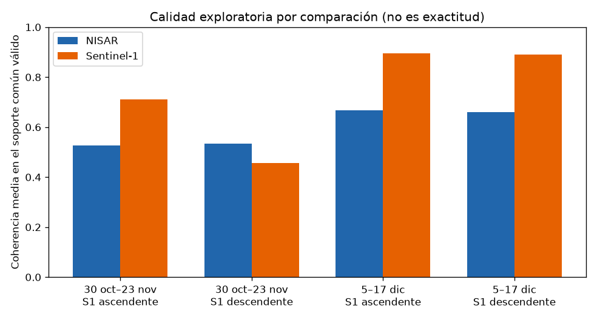

# Informe final del estudio actual

**Cierre de esta entrega, no validación científica definitiva.** Paquete del 5 de noviembre de 2026, 22:05 (Europa/Madrid). Sustituye al provisional de las 21:14. Manifiesto: `partial: false`. Los seis ZIP HyP3 tienen CRC de ZIP correcto; no se han vuelto a descargar ni se han lanzado jobs.

**Veredicto.** Piloto condicionado: genera y analiza interferogramas y desplazamiento aparente. La deformación real queda sin demostrar: el signo de la fase no está anclado, la atmósfera no está tratada y no hay RMSE con control local. La priorización de inspecciones es una vía de desarrollo, condicionada a integrar otras fuentes y a evaluar etiquetas. No está validado para detectar pozos ni para demostrar ilegalidad.

La exactitud sigue `no_evaluable`. `accuracy_improvement_pct` es null. No se aplica `100 * (err_S1 − err_NISAR) / err_S1`: no hay control independiente dentro de la tesela y el signo de la fase no está anclado.

## Hoja ejecutiva

| Pregunta | Respuesta con esta evidencia |
|---|---|
| ¿Qué produce el piloto en la tesela? | Interferogramas y desplazamiento aparente en 5×5 km de Rociana. El signo no está anclado, la atmósfera no está tratada y no hay RMSE con control local. |
| ¿Queda demostrada la deformación real? | No. |
| ¿La priorización de inspecciones está validada? | No. Es una vía de desarrollo, condicionada a integrar otras fuentes y a evaluar etiquetas. |
| ¿Cuántas ventanas NISAR hay? | **Dos:** 30 oct–23 nov 2025 (24 días) y 5–17 dic 2025 (12 días). No comparten fechas. |
| ¿Cuántas comparaciones hay? | **Cuatro:** cada ventana NISAR contra un Sentinel-1 ascendente y uno descendente, con un día de desfase en cada extremo. Cuatro comparaciones no son cuatro ventanas NISAR. |
| ¿NISAR supera a Sentinel-1 en coherencia? | No de forma uniforme. En tres de los cuatro casos, en el soporte común, Sentinel-1 está por encima. |
| ¿Eso localiza pozos o prueba ilegalidad? | No. No hay causación. La falta de inventario no es ilegalidad. |
| ¿Hasta dónde llega el dato? | La tesela y, aparte, el bbox de unos 20 km en EGMS. Ni toda Doñana ni todo 2025. |

## Seis productos Sentinel-1 procesados

El manifiesto `hyp3_six_zips_crc_sha256.json` lista seis ZIP, todos con `zip_crc_ok: true`, y coinciden con los seis jobs `SUCCEEDED` de `hyp3_jobs_sanitized.json`. No se han rehecho las sumas sobre los binarios.

| ZIP | Fechas | Papel en este informe |
|---|---|---|
| `S1AA_…_DCB0` | 29 oct–22 nov 2025 | Comparación ascendente de la primera ventana |
| `S1CC_…_B181` | 29 oct–22 nov 2025 | Comparación descendente de la primera ventana |
| `S1AA_…_6F69` | 4–16 dic 2025 | Comparación ascendente de la segunda ventana. Es el ZIP que faltaba a las 21:14 |
| `S1CC_…_C9F5` | 4–16 dic 2025 | Comparación descendente de la segunda ventana |
| `S1AA_…_4D20` | 22 nov–4 dic 2025 | Procesado. No es un caso controlado: no cae a menos de dos días de ninguna ventana NISAR |
| `S1DD_…_BA12` | 20 oct–1 nov **2026** | Procesado. No se compara con los GUNW de 2025 |

Los dos GUNW NISAR (EPSG:32630, fase en radianes, 1,229 GHz, λ = 0,2439320244 m, Ascending/Left) son los de los metadatos ya revisados. No están en la lista de ZIP.

## Cuatro comparaciones, soporte común

Cifras de `docs/evidencia-final-2026-11-05/controlled_pairs_descriptive.csv`. No se han recomputado. Rejilla NISAR nativa de 80 m en EPSG:32630; Sentinel-1 por vecino más próximo, sin promediar la coherencia. Cada fila tiene `n_independent_time_pairs = 1`. Los n son píxeles. El identificador incluye la geometría. La órbita de Sentinel-1 sale del vector de línea de visión y de la mira a la derecha, no de las letras `S1AA` o `S1CC`.

La diferencia que se lee es la absoluta (coherencia NISAR − coherencia Sentinel-1) en el soporte común válido. El porcentaje relativo es calidad exploratoria de ese caso. No es exactitud y no se generaliza.

| Ventana NISAR | Sentinel-1 | Desfase | Ángulo LOS | n válido | n usable común | Coh. NISAR | Coh. S1 | Δ absoluta | Δ % exploratoria | Exactitud |
|---|---|---|---:|---:|---:|---:|---:|---:|---:|---|
| 30 oct–23 nov | ascendente `…DCB0` | 1 día, 1 día | 87,1° | 2950 | 2676 | 0,526 | 0,711 | −0,185 | −26,0 | null |
| 30 oct–23 nov | descendente `…B181` | 1 día, 1 día | 22,5° | 1949 | 1263 | 0,534 | 0,456 | +0,078 | +17,0 | null |
| 5–17 dic | ascendente `…6F69` | 1 día, 1 día | 87,1° | 4047 | 3975 | 0,668 | 0,895 | −0,227 | −25,3 | null |
| 5–17 dic | descendente `…C9F5` | 1 día, 1 día | 22,5° | 2459 | 2398 | 0,660 | 0,891 | −0,232 | −26,0 | null |

Los tres primeros deltas coinciden con el paquete de las 21:14. El cuarto es nuevo. En tres casos NISAR queda por debajo. Solo el descendente de octubre–noviembre queda por encima (+0,078), y ese soporte común es el más pequeño (1949 píxeles válidos). No hay una ventaja uniforme.



NISAR mira a la izquierda y asciende. Sentinel-1 IW mira a la derecha. El ángulo entre los vectores hacia el satélite es 87,1° en los dos ascendentes y 22,5° en los dos descendentes. No se restan los desplazamientos como si fueran la misma componente. El signo de fase sigue sin anclar, así que tampoco se publican milímetros de subsidencia. La fórmula de mejora de error no se evalúa.

No se cita ninguna media de las dos ventanas NISAR contra un solo Sentinel-1. Ese agregado está descartado.

## GNSS, EGMS y el límite del área

Hay cuatro series NGL IGS20 con extremos en 2025 y cierre el 17 de octubre de 2026: HUE1 (29 km), HULV (30 km), HUEL (32 km) y LEBR (61 km). Ninguna está dentro de la tesela. No hay RMSE local ni porcentaje de exactitud. No se diga que no hay GNSS. Se diga que no hay control local anclado.

EGMS release 2020_2025 está leído. Es producto de Sentinel-1, no verdad independiente. Velocidad media en mm/año y `rmse_ts` en mm, según el formato v3. La tesela de 5×5 km y el bbox de unos 20 km están resumidos por separado. Las series llegan al 25, 28 o 29 de noviembre de 2025: hay unas fechas de octubre–noviembre y ninguna de la ventana del 5–17 de diciembre. No cubre toda Doñana ni todo 2025, y no valida el par de diciembre.

## Qué se puede hacer con esto, antes de descartar el proyecto

El piloto ya genera y analiza interferogramas en la tesela, con geometría y longitud de onda leídas del producto. El resultado es desplazamiento aparente. Con el signo sin anclar, la atmósfera sin tratar y sin RMSE frente a un control local, la deformación real queda sin demostrar. En los cuatro casos, la coherencia de banda L no queda por encima de la de banda C en todos ellos. La priorización de inspecciones no está validada: es una vía de desarrollo, condicionada a integrar otras fuentes y a evaluar etiquetas.

Orden de trabajo, si se continúa:

1. Una red de pares de 12 días que compartan fechas, en una geometría declarada, en lugar de dos pares NISAR sueltos.
2. Un control geodésico dentro de la tesela, signo anclado, y la proyección de ese control a cada línea de visión. Los mapas de incidencia y de look de HyP3 son el insumo; no se comparan LOS distintos sin esa proyección. La atmósfera se trata antes de interpretar milímetros.
3. Series de la CHG interpretadas en conjunto como variable hidrológica distinta del desplazamiento.
4. Sentinel-2, evapotranspiración o calendario de riego, más SIGPAC y concesiones, como fuentes a integrar antes de priorizar parcelas, y precisión y recall sobre una etiqueta cerrada de antemano. No se llama prueba de ilegalidad.

## Criterios de éxito, fijados antes de la próxima medida

No salen de la tabla de arriba.

- Una cadena de pares de 12 días que cubra octubre–junio en una geometría, con cada fecha intermedia en dos pares consecutivos.
- El signo contrastado con un control dentro de los 5 km, proyectado a esa línea de visión, y el contraste escrito antes de publicar milímetros.
- El umbral del RMSE se escribe antes de calcularlo. Este informe no lo elige.
- La coherencia se publica por comparación y por soporte. No es un criterio de que NISAR supere a Sentinel-1.
- El cruce con pozos, si se hace, publica precisión, recall y el tamaño de un conjunto etiquetado de antemano.

## Reproducibilidad

Cifras: `docs/evidencia-final-2026-11-05/`. Figura dibujada a partir de ese CSV, no de un ráster rehecho. Reglas de identificador y de órbita: `src/pares_controlados.py`. Cómo bajar y arrancar, sin secretos en git: `docs/11-guia-ejecucion-local.md`.

```bash
git clone https://github.com/j-novillo/MVP-NISAR-Donana-Water.git
cd MVP-NISAR-Donana-Water
git checkout cursor/poc-donana-insar-8c15
python3 -m venv .venv && source .venv/bin/activate
pip install -r requirements.txt
python -m pytest -q
```

HyP3: `HyP3(token=EARTHDATA_TOKEN)`. El catálogo de la ventana NISAR de 2025 es `--inicio 2025-10-01 --fin 2025-12-31`. El producto del 20 de octubre al 1 de noviembre de 2026 no entra en ese intervalo.
